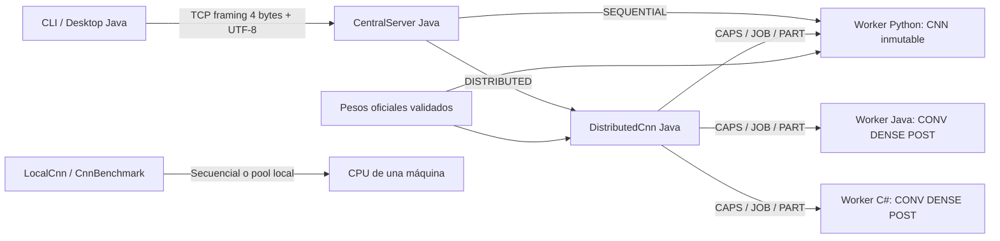

# Fase II — Concurrencia, paralelismo y procesamiento distribuido

Fecha: 2026-11-12 (America/Lima). Rama feature/ai-distributed. Estado de entrega: **IMPLEMENTACIÓN LISTA / DESPLIEGUE DISTRIBUIDO PENDIENTE**. Sólo hay un equipo disponible, confirmado por el usuario. Este documento responde al nuevo adjunto de fase II y complementa FASE2_DISTRIBUCION.md y WORKERS_TCP.md, que conservan la auditoría/correcciones anteriores.

## 1. Objetivo y revisión

Validar secuencial, concurrencia, paralelismo local, chunks entre workers, correlación, sincronización y recuperación. Se revisaron Git (base 798fee1, rama correcta y cambios anteriores sin commit), fases 0/I/II, CNN, workers, coordinador, servidor, benchmark, tests y contratos. Se conservaron las modificaciones previas. El PDF oficial sigue sin estar disponible en el repositorio: la matriz se usa provisionalmente.

No se reescribió CNN ni se modificaron pesos/dataset/contratos. No se añade RabbitMQ, entrenamiento distribuido, clientes ni BD. TCP entre backend y workers es el camino heredado comprobado; no se presenta como la conexión final backend→IA exigida con RabbitMQ.

## 2. Arquitectura real y componentes reutilizados



LocalCnn es la referencia Java del harness local, contrastada con la CNN Python. CentralServer, DistributedCnn y los tres workers ya existían. Se reutilizan tests de protocolo, IDENTIFY, distribución, Desktop y benchmark. Esta revisión agrega una prueba válida de frame grande y mediciones preliminares usando el harness existente; no duplica el benchmark.

## 3. Referencia secuencial y versión de pesos

CNN Python carga 837 parámetros validados, mantiene un snapshot inmutable y ejecuta dos convoluciones → ReLU/pooling → flatten98 → Dense8/ReLU → Dense3/Softmax. predict.py publica categoría, probabilidades y elapsed_ms. Mismos píxeles/pesos producen la misma salida. El entrenamiento no se ejecuta durante inferencia.

Los pesos oficiales identificados por SHA256 son df582438e8fa66b5f606408d646b8df3025f3e9b033dd780b17e45df0c550ec4. La prueba local de Java usa los mismos pesos y compara sus probabilidades con Python. Los clientes envían 256 valores normalizados [0,1]; el pipeline legado no transporta imágenes Base64 directamente.

## 4. Workers y responsabilidades

| Worker | Dirección de escucha / puerto por defecto | Operaciones | Capacidad predeterminada |
| --- | --- | --- | --- |
| Java | 0.0.0.0 / 9101 | CAPS, PING, JOB CONV/DENSE/POST; CONV/MLP legado | 4 cupos de cálculo, 64 conexiones |
| Python | 0.0.0.0 / 9102 | Lo anterior + IDENTIFY con CNN compartida | 1 cupo de cálculo, 64 conexiones |
| C# | IPAddress.Any / 9103 | CAPS, PING, JOB CONV/DENSE/POST; CONV/MLP legado | 4 cupos de cálculo, 64 conexiones |

La identidad operativa actual es endpoint host:puerto, acompañado del lenguaje anunciado en CAPS. No hay un UUID persistente del worker ni descubrimiento automático externo. El coordinador recibe endpoints por argumentos, descubre capacidades por petición y registra participantes/fallos. Salud disponible significa responder CAPS/PING; no hay heartbeat AMQP aún. Si un proceso cambia de endpoint se debe actualizar su configuración.

Argumento 1=puerto; argumento 2=cupos de cálculo (1..256). Entorno PC3_WORKER_MAX_CLIENTS=64 (1..1024), PC3_WORKER_TIMEOUT_MS=15000 (100..300000). Configuración inválida impide iniciar. IP de destino configurada en los argumentos del servidor; no se presume que localhost sea una máquina independiente. WORKERS_TCP.md contiene comandos manuales y alcance de cada opción.

## 5. TCP, framing y validación

Sockets SDK nativos: java.net, socket Python y System.Net.Sockets. Longitud de cuatro bytes big-endian seguida de cuerpo UTF-8, máximo 2,000,000 bytes. Las lecturas completas toleran fragmentación y varios frames en una conexión; una lectura no equivale a un mensaje. Vectores/matrices son CSV de números decimales finitos, orden por filas y dimensiones explícitas.

JOB identifica runId/taskId; PART devuelve IDs, rows/cols, valuesCsv y computeNs. Se valida número de campos, IDs, formas, cantidades, tamaños y finitud antes de ensamblar. Los errores de JOB conservan IDs válidos y código; los excesos de conexiones se cierran antes de leer IDs. Truncamientos, UTF-8 inválido, tamaño cero/excedido, timeout y desconexión no deben parar el proceso completo. No se cambia el contrato compartido.

Además de los rechazos por tamaño, la prueba nueva envía un JOB DENSE de aproximadamente 1.8 MB, permitido por el límite, a cada worker. Se calcula una salida conocida cero y se comprueban dimensiones/IDs/tiempo. Esto demuestra transferencia grande válida y no sólo rechazo de frames enormes.

## 6. Concurrencia, estado y sincronización

- Backend: ThreadPoolExecutor acotado, sin cola ilimitada de clientes. El cursor es AtomicInteger.
- Coordinador: executor/cola de chunks acotados; ConcurrentHashMap para sockets, participantes y runs; UUID+AtomicLong para IDs internos. Cada inferencia tiene su propio Run/tensores/deadline y ensamblado.
- Java worker: executor acotado de conexiones y Semaphore independiente para aritmética. Una conexión ociosa no retiene el único cupo de cálculo.
- Python worker: admisión con BoundedSemaphore antes de crear hilo y liberación en finally; slots de cálculo separados; Lock para carga fría única de CNN.
- C# worker: cupo reservado antes de Task.Run y liberado en finally; SemaphoreSlim separado para cálculo.
- Inferencia no actualiza pesos. Python publica el modelo validado de forma atómica; Java lo carga mediante volatile/synchronized. No hay lock global que serialice todas las solicitudes del coordinador.

El modelo matemático es inmutable durante una inferencia. Conexiones/hilos tienen límites, pero no se promete equidad estricta o cancelación instantánea de aritmética ya iniciada. Estado/cupos deben liberarse ante errores. La cancelación del coordinador cancela futures pendientes y cierra sockets; la GUI también prueba timeout/cancelación de sus recursos. Un cliente que se desconecta no revierte una operación CPU ya empezada; el coordinador mantiene su deadline.

## 7. Paralelismo real y presupuestos

Dos filtros son independientes; dentro de Dense cada neurona/fila se calcula desde las mismas entradas completas. LocalCnn ejecuta esas tareas con un pool Java de tamaño configurado y barreras por capa. PhysicalConfig verifica afinidad física antes/después. Los contadores publican IDs de hilos matemáticos y máximo de tareas activas. No se infiere paralelismo a partir del nombre de una clase.

Los workers Java/C# permiten ejecutar JOB independientes en varios cupos. Python usa threading para atender I/O/conexiones, pero múltiples hilos no garantizan CPU paralela bajo GIL. node_agent puede lanzar un proceso Python de un hilo por núcleo; es el mecanismo existente para escenarios posteriores, no un entrenamiento multiproceso añadido aquí.

Los experimentos preliminares usan un proceso JVM local con uno o dos hilos matemáticos y uno o dos núcleos físicos permitidos, además de hilos auxiliares de emisión/GC/JIT. No se afirma que la JVM tenga un solo hilo total. La prueba de seis núcleos disjuntos permanece omitida: el equipo tiene cuatro físicos/ocho lógicos.

## 8. Chunks y asignación

DistributedCnn toma endpoints únicos en orden de configuración y descubre CAPS. Exige al menos dos workers capaces de CONV y DENSE. Asigna cada chunk a un índice preferido y, si falla, prueba los siguientes circularmente dentro de los nodos capaces. Es una política determinista simple, no balanceo adaptativo por carga.

Las dos convoluciones son dos chunks. Dense se divide por filas de salida: con tres workers y configuración predeterminada hay tres chunks ocultos y tres de salida, ocho chunks en total. Cada resultado se inserta por offset, no por llegada. Ninguna capa se lanza antes de completar todos los resultados necesarios de la anterior. Pooling/ReLU/softmax se realizan localmente por defecto; remotePostprocess puede delegarlos mediante POST. Flatten sólo reorganiza valores.

## 9. Secuencia y barreras

```mermaid
sequenceDiagram
    participant C as Cliente
    participant S as CentralServer
    participant D as DistributedCnn
    participant J as Java
    participant P as Python
    participant N as C#
    C->>S: IDENTIFY | id externo | pixels | DISTRIBUTED
    S->>D: identify(id, pixels)
    D->>J: CAPS | runId
    D->>P: CAPS | runId
    D->>N: CAPS | runId
    par Filtros independientes
        D->>J: JOB | runId | conv-0
        J-->>D: PART conv-0
    and
        D->>P: JOB | runId | conv-1
        P-->>D: PART conv-1
    end
    Note over D: Barrera CONV; pooling y flatten completos
    par Filas ocultas
        D->>N: JOB hidden-0-2
        N-->>D: PART
    and
        D->>J: JOB hidden-3-5
        J-->>D: PART
    and
        D->>P: JOB hidden-6-7
        P-->>D: PART
    end
    Note over D: Barrera Dense oculta; ReLU
    D->>N: JOB output-0-0
    D->>J: JOB output-1-1
    D->>P: JOB output-2-2
    N-->>D: PART
    J-->>D: PART
    P-->>D: PART
    Note over D: Barrera salida; softmax; validar participantes
    D-->>S: RESULT con id externo y probabilidades
    S-->>C: RESULT
```

Diagrama del caso predeterminado sin fallos y con endpoints Java/Python/C# en ese orden. La llegada real puede ser distinta; los tests la alteran deliberadamente y comprueban barreras/offsets.

## 10. Errores y recuperación

Deadlines monotónicos de lectura incluyen header+cuerpo completo; fragmentos lentos no renuevan el plazo. Coordinador limita cada RPC y la solicitud global, cierra sockets vencidos, marca endpoints fallidos por Run y reintenta chunks seguros. PART con otro ID/task/forma/NaN/tiempo inválido se rechaza. Sin resultados válidos completos devuelve ERROR; nunca una predicción parcial.

Cola llena devuelve coordinator_busy; sin suficientes workers devuelve insufficient_workers. No hay fallback silencioso de DISTRIBUTED a IDENTIFY completo. Las operaciones son inferencia pura: repetir cálculo es seguro, pero esto no equivale a idempotencia durable de futuras escrituras/colas. El coordinador usa snapshots cacheados: la promoción de pesos en disco requerirá versionado/reinicio acordado posteriormente.

## 11. Pruebas y consistencia matemática

Ver FASE2_RESULTADOS.md para campaña nueva, comandos y conteos. Se reutilizan tests de 300 imágenes y comparación de cada probabilidad/capa, tres lenguajes, 48 solicitudes concurrentes con ID externo compartido (36 runs DISTRIBUTED internos distintos), desorden y barreras, corrupción, worker lento/caído/reincorporado, saturación y cancelación/recuperación.

Tolerancia TCP absoluta 1e-8 por diferencias de serialización/aritmética de runtimes. No se compara sólo la etiqueta. Java local secuencial/paralelo se contrasta con Python a 1e-12. Las regresiones CNN de fase I y Desktop se ejecutan junto a las de comunicación. Los proxies de fallo reenvían a workers matemáticos reales; no fabrican predicciones aceptadas como correctas.

## 12. Experimentos y limitaciones

Se ejecutan tres repeticiones por configuración, 1000 solicitudes por repetición, 100 warmups y datos de test 16×16 muestreados con seed fija. Se reutilizan Benchmark/CnnBenchmark/LocalCnn/PhysicalConfig/resource_probe y prepare_inputs. El CSV registra IDs, delays, errores, probabilidades y latencias. La instrumentación reporta afinidad, hilos matemáticos/peak, CPU de cálculo local y resumen de carga; GNU time registra recursos del lanzamiento completo con alcance distinto.

No se ejecutan mediciones mientras la suite integral está activa. No hay aislamiento de la máquina respecto de otras aplicaciones; resultados preliminares, no campaña definitiva ni garantía de aceleración. Latencia excluye think-delay, lectura de archivos y preprocesamiento; throughput usa duración de carga e incluye delays. Una media de p95 por repetición no es el p95 combinado de todos los CSV.

La ruta TCP concurrente agrega backend/worker/network loopback; no es directamente comparable con un método Java local como si sólo cambiara el número de hilos. No se mide inferencia entre máquinas independientes porque no están disponibles. No se mide entrenamiento distribuido ni las 1000 transacciones finales Android/Desktop/Web/RabbitMQ/BD.

## 13. Preparación de fase III (sin implementación)

Acordar con integrante 1 el mensaje JSON versionado y las colas de contracts/RABBITMQ_V1.md; actualmente son propuestas. El adaptador IA futuro validará imagenBase64 o referencia, normalizará a 256 píxeles, seleccionará snapshot/versionId y llamará al núcleo validado (CNN Python o servicio de coordinación encapsulado en nodo IA según despliegue aprobado). Emitirá probabilidades, clase, versión y estado conservando idSolicitud/idCliente.

Definir antes de conectar: routing/modelo A/B según profesor, quién coordina persistencia/validación, ack después de resultado confirmado, publisher confirms, reintentos/DLQ/TTL, timeout, duplicados, tamaño y errores, heartbeat/control y métricas. El backend debe comunicarse con el nodo IA por RabbitMQ en el diseño final; el TCP interno legado se conserva para compatibilidad/pruebas y no se eleva automáticamente a arquitectura final. No se modifican contratos unilateralmente.

## 14. Cierre

Criterios locales: implementación y evidencia de inferencia, concurrencia, paralelismo local, tres workers, sincronización, errores y equivalencia. Falta red real entre equipos/SO independientes, PDF/decisiones docentes, escenario de seis núcleos y campañas completas posteriores. La evaluación externa de imágenes de fase I también sigue pendiente.

**IMPLEMENTACIÓN LISTA / DESPLIEGUE DISTRIBUIDO PENDIENTE**. No afirmar distribución real por localhost. No se inicia fase III ni fase IV; sin commit, push, merge ni rebase.
