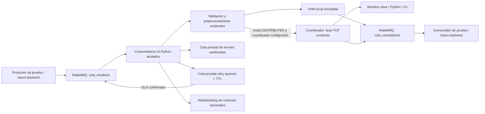
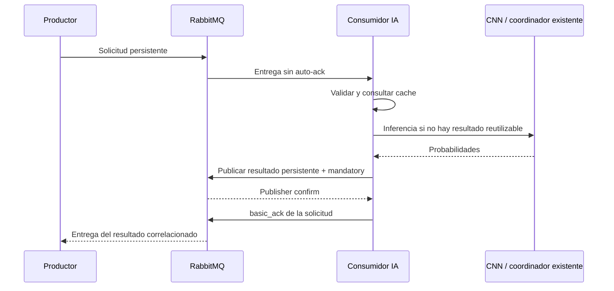

# Fase III — Nodo IA con RabbitMQ

Fecha: 2026-11-12 (America/Lima). Rama feature/ai-distributed. **Flujo AMQP real del nodo IA verificado localmente; integración con backend/BD y despliegue entre equipos pendientes.** Se conserva la CNN, pesos, dataset, workers TCP y trabajo de fases anteriores. No se inicia fase IV.

## 1. Auditoría y decisiones de integración

Se revisaron README, MATRIZ_PC3, ARQUITECTURA_PC3, PLAN_INTEGRACION, fases I/II, contratos y fuentes reales. La rama sigue en base 798fee1; hay trabajo previo sin commit que se preservó. El PDF oficial no está disponible en el repositorio, por lo que la aceptación docente de dependencias/arquitectura sigue pendiente.

Se encontró un avance del integrante 1 en el commit **8901cfb**, disponible en otra referencia Git. Se inspeccionaron contrato, DTOs, RabbitMQManager y README, sin hacer merge/cherry-pick ni modificar sus archivos. Ese backend no está incorporado a esta rama y requiere PostgreSQL. No se afirma haber ejecutado aquí su flujo completo.

Hay dos formatos incompatibles: nuestra rama ejemplifica archivo PNG Base64 dentro de payload; 8901cfb usa CSV de 256 píxeles en un campo top-level llamado imagenBase64. El usuario autorizó soportar ambos. Se seleccionan por **tipo de mensaje**, nunca tratando arbitrariamente CSV como Base64. Los contratos compartidos se conservan sin cambios. Esta adaptación y las colas auxiliares deben revisarse con integrante 1 antes de integrar el PR.

## 2. Arquitectura implementada



Backend→IA usa AMQP en este adaptador. TCP sólo se reutiliza como opción explícita hacia el coordinador legado para microchunks, sin introducir nuevas conexiones entre backend y BD ni declarar que ese despliegue sea la arquitectura final aprobada. Si la restricción docente requiere AMQP también entre nodos internos IA, habrá que adaptar ese transporte antes de desplegarlo: la CNN no necesita reescribirse.

## 3. Archivos y responsabilidades

| Archivo | Responsabilidad |
| --- | --- |
| workers/python/rabbit_config.py | Entorno validado, credenciales fuera de código, límites y colas |
| workers/python/rabbit_messages.py | JSON, perfiles, Base64/CSV, correlación y respuestas estructuradas |
| workers/python/ia_service.py | CNN inmutable o RPC al coordinador existente; cache LRU/TTL y coalescing |
| workers/python/rabbit_worker.py | Conexiones/canales, consumo, confirms, ack, retry, errores y eventos |
| workers/python/requirements-amqp.txt | Única dependencia nueva: Pika==1.3.2 |
| workers/python/.env.example | Ejemplo sin credenciales reales; no se carga automáticamente |
| scripts/probe_rabbit_ia.py | Productor/consumidor real aislado y carga, sin dashboard ni segundo harness CNN |
| tests/test_rabbit_*.py | Unit tests separados de broker real y puente AMQP→TCP |

Pika sólo implementa transporte AMQP 0-9-1; ninguna operación matemática de IA se delega. Se instaló en /tmp/pc3-amqp-deps para verificar, sin instalación global. La [documentación oficial RabbitMQ para Python](https://www.rabbitmq.com/tutorials/tutorial-two-python) emplea este cliente; la autorización específica del profesor sigue pendiente del PDF. La lógica matemática continúa usando únicamente biblioteca estándar.

## 4. Topología exacta

Exchange por defecto `""`, routing key igual al nombre de cola. Sin exchange nuevo obligatorio ni modificación de las declaraciones backend existentes.

| Cola por defecto | Publicador / consumidor | Propiedades |
| --- | --- | --- |
| cola_modeloA | Backend/prueba → IA | Durable; declaración sin argumentos extra, compatible con backend |
| cola_resultadosA | IA → backend/prueba | Durable; resultado persistente y correlacionado |
| cola_modeloA.ia_retry | IA → broker DLX → cola_modeloA | Quorum durable, TTL 1000 ms por defecto, dead-letter-strategy at-least-once, overflow reject-publish, máximo 16000000 bytes |
| cola_modeloA.ia_errores | IA → diagnóstico | Durable; error estructurado y SHA256 del cuerpo, sin imagen cruda |
| cola_control_heartbeat | IA → monitor futuro | Opcional IA_PUBLISH_CONTROL=1; durable; heartbeat de dominio cada 15 s desde consumidor 0 |
| cola_logs | IA → observador futuro | Opcional; evento de conexión, sin imágenes/credenciales |

Las dos colas auxiliares son propuesta del adaptador, configurables y pendientes de acuerdo, no una modificación silenciosa del contrato del equipo. Un nombre existente con argumentos incompatibles provoca error de declaración/reconexión; no se borra ni reconfigura automáticamente. Se requiere RabbitMQ >=3.10 con soporte de dead-letter al menos una vez y feature flags necesarios; se verificó RabbitMQ **4.4.0**. Si hay una cola retry clásica con ese mismo nombre, usar otro nombre o migrarla de forma acordada, nunca eliminarla automáticamente.

Una cola clásica TTL/DLX puede transferir sin confirmación interna. La cola retry privada quorum usa la [estrategia documentada de dead-letter al menos una vez](https://www.rabbitmq.com/docs/quorum-queues), reteniendo el mensaje hasta confirmación de destino. Es una capacidad del broker, no una implementación propia de consenso. Una sola instancia local no aporta alta disponibilidad ni protege frente a pérdida permanente de su disco.

No se crean colas B ni un modelo B ficticio. El único modelo aceptado es A; cambiar IA_MODEL_NAME a B falla al iniciar.

## 5. Contratos soportados

Campos comunes: schemaVersion entero 1; idSolicitud/idCliente válidos; modeloDestino=A; timestamp ISO8601 con zona; intento entero 1..10; payload objeto. Si correlation_id AMQP está presente debe coincidir con idSolicitud; el backend 8901cfb no lo envía y se acepta ausente. La respuesta siempre incluye correlation_id/message_id=idSolicitud.

**Perfil repository-v1** (ejemplo de esta rama): tipo=CLASIFICAR_IMAGEN, payload.mimeType=image/png o image/x-portable-graymap y payload.imagenBase64=archivo codificado. Respuesta tipo=RESULTADO_CLASIFICACION, payload.etiqueta, probabilidades como objeto por clase y duracionMs; se añaden estado, versionPesos y error de manera explícita.

**Perfil backend-8901cfb**: tipo=INFERENCIA, imagenBase64 top-level contiene CSV de 256 valores normalizados; payload.modo=SEQUENTIAL o DISTRIBUTED. Respuesta estado=COMPLETADA, error=null, payload.etiqueta/probabilidad/probabilidades como lista ordenada [circulo,cruz,triangulo]/duracionMs. Se conservan campos extra de correlación/modelo/versionPesos que Gson ignora al deserializar el DTO inspeccionado. Error usa estado=ERROR, error=código y payload con codigo/descripcion. El nodo no afirma éxito cuando falla.

Esta compatibilidad fue verificada con mensajes reales de ambas formas y contra los tipos del DTO inspeccionado, **no mediante ejecución del backend con PostgreSQL**. El nombre imagenBase64 para CSV es una deuda del contrato del otro commit; no se renombra unilateralmente.

## 6. Validación y límites

Cuerpo máximo 2000000 bytes; archivo decodificado máximo 1000000 bytes; raster máximo 262144 píxeles. PNG comprueba dimensiones del header antes de decodificar y después se reutiliza el decoder validado (CRC/formato/límites). PGM queda acotado por archivo y se comprueban dimensiones tras la decodificación. Base64 estricto, MIME limitado, JSON sin claves duplicadas/NaN/Infinity, etiquetas/modelo/IDs/modo/correlación validados.

Normalización y redimensión son las mismas de fase I. Una solicitud inválida no se pasa a CNN. Los logs no incluyen cuerpos/imágenes, credenciales ni excepciones de transporte que puedan contener URLs secretas. IA_WEIGHTS es opcional; por defecto se usan los pesos oficiales. Se comprueba que el archivo no cambie durante la carga y se publica su SHA256; la CNN es inmutable en inferencia.

## 7. Concurrencia y seguridad de canales

Un hilo consumidor por capacidad configurada, **una conexión y un canal Pika creados/usados por ese mismo hilo**. No se comparten canales entre hilos. IA_WORKER_CONCURRENCY=2 (1..16), IA_PREFETCH=1 (1..4) por consumidor; entregas sin ack acotadas por consumidores×prefetch, sin executor interno ilimitado. Cada consumidor procesa una tarea a la vez. Varios hilos aportan concurrencia de I/O; no se presentan como paralelismo CPU garantizado bajo GIL.

Conexiones procesan eventos durante periodos de inactividad. El timeout de operación debe ser menor que heartbeat/2. Para CPU local, el timeout se comprueba al terminar; **no preempta un decoder/cálculo Python ya iniciado**. Los tamaños se acotan y la CNN es pequeña. El camino TCP sí usa un deadline monotónico global y valida CONFIG/hash de pesos antes de IDENTIFY DISTRIBUTED.

## 8. Secuencia, ack y fallos



Publicación confirmada y mandatory: una ruta ausente o NACK de publicación no produce ack de entrada. Se cierra sesión y el broker puede reentregar. Un resultado ya confirmado puede duplicarse si se pierde la conexión antes del ack; no hay transacción atómica entre publish y ack.

Error temporal: publicar solicitud en retry con x-ia-attempt incrementado, esperar confirmación y luego ack original. TTL evita bucle inmediato; máximo tres intentos por defecto. Tras agotar, publicar resultado ERROR y registro sanitizado de errores antes del ack. Error permanente: mismo flujo sin retry; si falta ID válido, sólo registro sanitizado en cola de errores. El encabezado de intento se valida y no se mezcla con un ilimitado nack(requeue=true).

La cola de errores contiene diagnóstico, no una copia completa del cuerpo para replay: elección explícita para no replicar imágenes. La política de conservar/reprocesar imágenes fallidas debe acordarse con backend/BD.

Desconexión: cada consumidor reconecta con espera 1,2,4,... hasta 30 s; aplica de nuevo colas/QoS/confirms. Configuración/credenciales erróneas se registran por tipo de estado sin imprimir secretos. No hay bucle intensivo de CPU. SIGINT/SIGTERM activan Event, terminan consumo, cierran conexiones propias y esperan hilos; mensajes pendientes no confirmados son reentregables. No se garantiza finalización instantánea de CPU ya iniciada.

## 9. Duplicados y garantías reales

Cache LRU/TTL compartida por proceso, 4096 entradas/3600 s por defecto; key=(modelo,idSolicitud), fingerprint de cliente/perfil/modo/píxeles. Un Future sincroniza duplicados en vuelo sin ejecutar otra inferencia; distinto contenido con mismo ID produce idempotency_conflict. No se retiene el lock durante CNN/RPC. Los errores temporales se eliminan de cache para permitir reintento. Un resultado calculado puede reutilizarse si falló su publicación.

Cache no persistente, no compartida entre procesos y expirable: tras reinicio/evicción puede repetirse cálculo, que es puro y no escribe BD. El backend y persistencia deben deduplicar efectos por idSolicitud. **Entrega al menos una vez; nunca exactamente una vez.** También puede duplicarse un error o un resultado al fallar una publicación/ack intermedio. El adaptador no reemplaza idempotencia durable del equipo.

## 10. Métricas y control

Eventos JSONL opcionales IA_METRICS_FILE, también en stdout: idSolicitud válido o null, worker/modelo, recepción/finalización UTC, estado, intento/error, inferenciaMs y totalNodoMs. Contadores por proceso y eventos de conexión. Un DUPLICADO reporta cero inferencia nueva en el evento, aunque el resultado cacheado conserva la duración original para permanecer idéntico.

InferenciaMs no es latencia de cliente; totalNodoMs incluye validación/cache/publicaciones/ack. El probe mide publicación→recepción y cuenta instrumentación/confirmaciones/polling. Profundidad observada es sólo mensajes listos vía queue.declare passive; sin management API no se inventan unacked ni tasas del broker.

Heartbeat AMQP de conexión está siempre configurado; heartbeat de dominio y log de conexión sólo al habilitar control. Ese esquema de eventos es propuesta IA, pendiente de acuerdo con monitor del integrante 1. Contadores se reinician al reiniciar el proceso; no son totales históricos del sistema.

## 11. Iniciar y detener en Ubuntu / Windows

Crear entorno virtual local y instalar únicamente requirements-amqp.txt, sin paquetes globales. El ejemplo .env no se interpreta automáticamente; exportar variables o configurar el supervisor.

Ubuntu, desde raíz:

```bash
python3 -m venv .venv
. .venv/bin/activate
python -m pip install -r workers/python/requirements-amqp.txt
export RABBITMQ_HOST=localhost
export RABBITMQ_PORT=5672
export RABBITMQ_VHOST=mi_vhost_ia
export RABBITMQ_USER=mi_usuario_ia
read -rsp 'RabbitMQ password: ' RABBITMQ_PASSWORD
export RABBITMQ_PASSWORD
export IA_WORKER_CONCURRENCY=2
export IA_METRICS_FILE=build/phase3/ia-events.jsonl
python workers/python/rabbit_worker.py
```

Detener con Ctrl+C o SIGTERM al proceso propio. El broker debe existir previamente; el worker no instala ni reconfigura servicios del sistema.

Windows PowerShell:

```powershell
py -m venv .venv
.\.venv\Scripts\Activate.ps1
python -m pip install -r workers/python/requirements-amqp.txt
$env:RABBITMQ_HOST='localhost'
$env:RABBITMQ_PORT='5672'
$env:RABBITMQ_VHOST='mi_vhost_ia'
$cred=Get-Credential
$env:RABBITMQ_USER=$cred.UserName
$env:RABBITMQ_PASSWORD=$cred.GetNetworkCredential().Password
$env:IA_WORKER_CONCURRENCY='2'
$env:IA_METRICS_FILE='build/phase3/ia-events.jsonl'
python workers/python/rabbit_worker.py
```

Detener con Ctrl+C. Código Python/Pika portable; **Windows no se ejecutó en esta sesión**. Para red, coordinar usuario/vhost/permisos y transporte TLS con integrante 1; el ejemplo sólo configura AMQP, no TLS. No usar credenciales predeterminadas en despliegue de red.

## 12. Pruebas, evidencia y pendientes

FASE3_RESULTADOS.md registra unit tests, broker real RabbitMQ 4.4.0, corte de conexiones, restart de consumidor, stop_app/start_app del broker, control, duplicados/retry/error y puente AMQP→coordinador→tres lenguajes. La prueba usa instancia/colas temporales propias en loopback; no toca ni detiene el RabbitMQ ajeno que ya existía.

Se ejecutan regresiones de fases I/II y cargas con ambos perfiles y distintas imágenes/concurrencias. Los JSON conservados incluyen hashes; ni pesos ni dataset oficiales cambian. No se declara despliegue físico distribuido, compatibilidad Windows probada, backend/BD integrado ni prueba final de 1000 transacciones de tres clientes.

Pendientes con integrante 1: confirmar perfiles y transición CSV/Base64; aprobar colas retry/errores/control y versión broker; configurar credenciales/vhost/TLS/permisos; definir deduplicación durable, errores, deadline total y routing de persistencia. **Su backend espera 25 s; tres intentos de RPC de 10 s más TTL/publicaciones pueden superar ese límite**. Alinear presupuestos antes de integración; no se oculta esa diferencia porque las inferencias locales sean rápidas.

Flujo PC3 completo aún pendiente: Cliente→Backend→RabbitMQ→Nodo IA→RabbitMQ→Nodo BD→RabbitMQ→Backend→Cliente. Nodo BD y clientes son responsabilidad de los compañeros, sin implementación añadida aquí.

Fase IV futura: snapshots/versiones de pesos, gradientes por muestra/batch, agregación ponderada con barreras y deduplicación por paso/chunk, único estado coherente de Adam y recuperación/checkpoints. No se implementa entrenamiento distribuido en esta fase.
