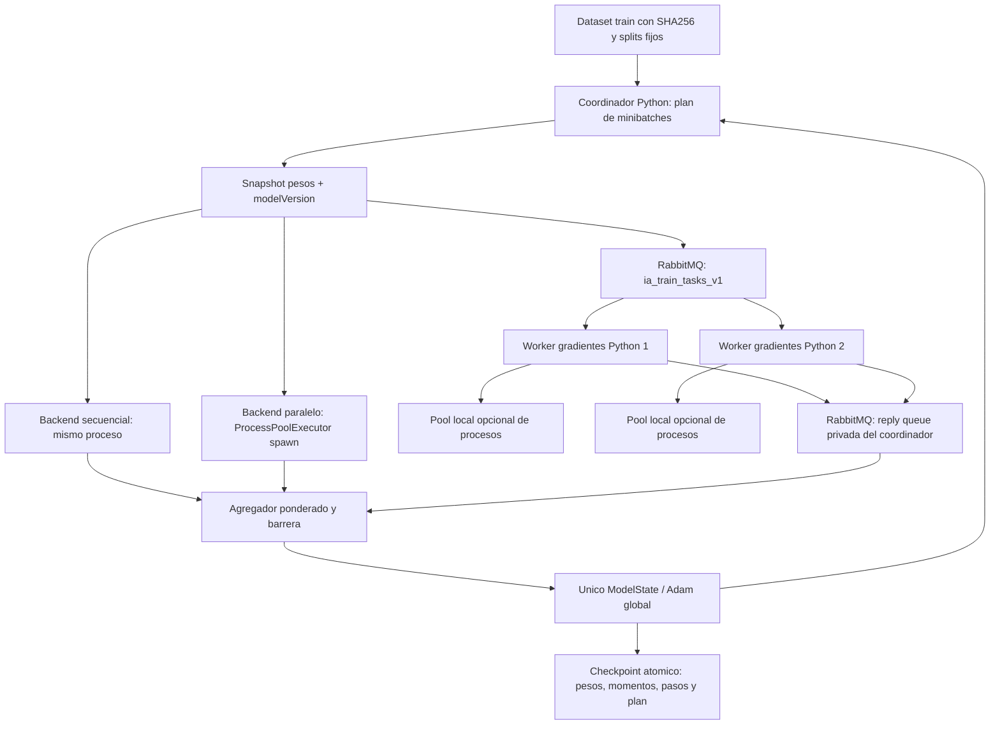

# Fase IV — Entrenamiento paralelo y distribuido CNN + MLP

Fecha: 2026-11-12 (America/Lima). Rama feature/ai-distributed. **IMPLEMENTACIÓN DISPONIBLE — VALIDACIÓN DISTRIBUIDA PENDIENTE**. Hay entrenamiento paralelo con procesos y entrenamiento AMQP real entre procesos de un solo equipo. No se acredita entrenamiento entre máquinas independientes ni heterogeneidad de lenguajes en el backward.

## 1. Revisión y alcance

Se revisaron Git, matriz/arquitectura/contratos y evidencia de fases I–III. Se conservaron todos los cambios previos sin commit. El PDF oficial continúa no disponible; interpretaciones docentes pendientes. La CNN/backward ya estaban comprobados y RabbitMQ tenía flujo local real. No se reemplazan redes matemáticas, dataset, pesos oficiales, backend, clientes ni contratos de inferencia. No se inicia fase V.

Java/C# conservan sus funciones de inferencia TCP comprobadas; **no calculan gradientes**. Para entrenamiento se reutiliza el backward Python en procesos/consumidores independientes. Si el profesor exige que cada uno de los tres lenguajes participe en entrenamiento, esa ampliación requiere aclaración y nuevas operaciones verificadas; no se da por satisfecha con inferencia.

## 2. Arquitectura real



Se reutiliza Pika/configuración/confirmaciones de fase III y sus colas auxiliares como patrón, pero **con nombres privados de entrenamiento**. No se publican tareas TRAIN_TASK en cola_modeloA ni se mezcla el protocolo con el del integrante 1. Cada llamada de evaluación usa CNN validada, sin alterar el snapshot de inferencia oficial.

## 3. Módulos

| Archivo | Función |
| --- | --- |
| cnn_python/training_math.py | compute_gradients y Adam compartidos, sin transporte |
| cnn_python/gradient_protocol.py | Snapshots, mensajes y hashes; validación, particiones y agregación |
| cnn_python/model_state.py | Versiones, commit idempotente, lock, checkpoint íntegro y lease del coordinador |
| cnn_python/training_backends.py | Secuencial y pool persistente spawn, timeout/cancelación |
| cnn_python/training_amqp.py | Publicación/correlación/reintentos de tareas y barrera de resultados |
| cnn_python/train_synchronous.py | Plan determinista, entrenamiento/evaluación, CLI y resume |
| workers/python/training_worker.py | Gradientes puros, dataset local verificado, publicación/ack; pool local opcional |
| cnn_python/train.py | Refactor pequeño para reutilizar cálculo y Adam, preservando firma/reportes |

No se añade dependencia externa. Se utiliza Pika==1.3.2 ya introducido en fase III; matemática/multiprocessing/checkpoints usan biblioteca estándar. El entrenamiento original mantiene su selección/patience; la CLI síncrona nueva compara un número **fijo** de épocas y selecciona el mejor checkpoint por validación, sin early stopping adicional.

## 4. Referencia secuencial y refactor

Antes de editar train.py se ejecutó una referencia de 24 train (8/clase), 9 validation (3/clase), tres épocas, batch=5, seed=23. Después de extraer compute_gradients/Adam, la diferencia máxima de sus 837 pesos fue **0.0**. Los tests existentes de descenso, cambios de capas, gradientes y Adam siguen verificando la implementación real.

El único cambio numérico no sustancial del historial es la forma de acumular la loss online de batches: se suma la media por tamaño; puede diferir en ulps frente a acumular cada muestra globalmente. No se modifican forward/backward ni los coeficientes de Adam.

## 5. Gradientes y agregación

`compute_gradients(weights,batch)` devuelve loss media y gradientes medios de todas las secciones, sin mutar pesos ni aplicar Adam. Se reutiliza loss_and_gradients validado. Imágenes, etiquetas, dimensiones y finitud se verifican.

Para particiones de tamaños n_i y medias G_i:

`G = sum(n_i * G_i) / sum(n_i)`; `L = sum(n_i * L_i) / sum(n_i)`.

Se usa math.fsum en el agregador, con orden de particiones estable. No se promedian medias sin ponderar ni se promedian pesos entrenados localmente. Se detectan particiones superpuestas, faltantes, tareas no asignadas, conteos incorrectos, NaN/inf y duplicados conflictivos. Un duplicado idéntico no aporta otro término.

Prueba fundamental: batch de siete ejemplos, particiones 3/2/2, comparar los 837 gradientes y un paso Adam con la referencia secuencial. Tolerancia absoluta 1e-12; pesos finales de entrenamiento corto 1e-10. Se incluye caso conocido de medias 1 y 3 con tamaños 2 y 1: resultado 5/3, no 2.

## 6. Snapshots y versiones

Toda tarea identifica runId, epoch, batchId, taskId, modelVersion, weightsHash, datasetHash, indices y count. Pesos completos son 837 valores, serializados en JSON finito con límite de cuerpo 2000000 bytes y hash canónico; no se envía el dataset completo por paso.

Los workers cargan una sola vez su ZIP local de entrenamiento y comprueban SHA256 exacto. El coordinador envía índices de train (máximo 256 muestras por tarea); un worker con otro dataset rechaza. En nodos independientes hay que distribuir el **mismo ZIP original en bytes**, no regenerar un ZIP equivalente con metadatos de plataforma distintos, y configurar IA_TRAIN_DATASET en cada nodo.

Un resultado TRAIN_GRADIENT_RESULT devuelve todos los identificadores/versiones/hashes, count, meanLoss, gradientes, PID/hostname/OS/workerId y tiempos. El coordinador valida antes de agregar; versiones antiguas o mezcladas nunca llegan a Adam. Los mensajes/IDs no sustituyen autenticación del broker: los participantes autorizados son responsables de calcular correctamente.

## 7. Único actualizador Adam

ModelState es dueño de pesos, versión, momentos primero/segundo, contador y registro de pasos aceptados. Un RLock hace atómico commit incluso ante llamadas duplicadas simultáneas. Un commit ya aceptado con misma versión/hash devuelve False; otro contenido o versión obsoleta produce error. La actualización se calcula en buffers independientes y se publica completa al finalizar.

Adam se ejecuta **una vez por minibatch global**: medias agregadas → clipping de norma global a 5 → momentos beta1=.9/beta2=.999 → correcciones de sesgo → actualización lr/(sqrt(vhat)+1e-8). Version y step avanzan juntos. Workers no poseen Adam ni aplican actualizaciones locales. No se mantienen locks de ModelState durante red o cálculo de gradientes.

## 8. Secuencia de un paso

```mermaid
sequenceDiagram
    participant C as Coordinador
    participant B as RabbitMQ
    participant W1 as Gradientes Python 1
    participant W2 as Gradientes Python 2
    participant A as ModelState / Adam
    C->>A: Snapshot version v
    C->>B: TRAIN_TASK particion 0, pesos v, indices y hashes
    C->>B: TRAIN_TASK particion 1, mismos pesos v
    B->>W1: Entrega sin auto-ack
    B->>W2: Entrega sin auto-ack
    W1->>W1: Backward puro de sus ejemplos
    W2->>W2: Backward puro de sus ejemplos
    W1->>B: TRAIN_GRADIENT_RESULT + publisher confirm
    W1->>B: Ack tarea
    W2->>B: TRAIN_GRADIENT_RESULT + publisher confirm
    W2->>B: Ack tarea
    B-->>C: Resultados en cualquier orden
    C->>C: Validar IDs/version/formas; deduplicar; barrera completa
    C->>A: Commit una vez del gradiente ponderado
    A-->>C: Version v+1
    C->>C: Guardar checkpoint atomico antes del siguiente paso
```

## 9. Paralelismo local

ProcessPoolExecutor con contexto spawn (sin depender de fork). Se crea una vez, inicializa datos locales una vez por proceso, usa barrera de arranque y se reutiliza entre batches. Máximo 16 procesos; cantidad de tareas por paso acotada por particiones (máximo 16) y batch global <=256. No crea un proceso por imagen.

Futures tienen deadline del mapa. Error/timeout cancela pendientes y aborta el paso sin aplicar contribuciones parciales. Python 3.14 permite terminate_workers(); en versiones anteriores se cancela lo pendiente y los cálculos ya iniciados pueden finalizar: no se promete preempción instantánea. Un pool roto requiere reiniciar ese backend/worker. La CLI cierra pools en finally.

Se verificaron dos PIDs distintos calculando gradientes y CPU de procesos. En el experimento, los workers paralelos sumaron aproximadamente 3.69 s CPU en 2.01 s de fase map: evidencia de ejecución CPU simultánea, no sólo hilos sujetos a GIL. No se fijó afinidad por proceso en estas mediciones; no se afirma asignación exclusiva a dos núcleos físicos.

## 10. RabbitMQ: topología propuesta de entrenamiento

| Elemento | Nombre/configuración |
| --- | --- |
| Cola de tareas | IA_TRAIN_QUEUE, default ia_train_tasks_v1, durable |
| Reply queue por coordinador | ia-train-results-UUID, exclusive/auto-delete, sólo sesión actual |
| Cola de retry de publicación worker | IA_TRAIN_RETRY_QUEUE, default ia_train_retry_v1, quorum TTL/DLX al menos una vez de fase III |
| Cola de errores | IA_TRAIN_ERROR_QUEUE, default ia_train_errors_v1, durable, diagnóstico acotado |
| Cola reservada de resultados | IA_TRAIN_RESULT_QUEUE, default ia_train_results_v1, declarada por reutilización de configuración; no es la reply queue utilizada para la barrera |
| Exchange / routing | Exchange por defecto vacío, routing key=cola |

Mensajes privados tipo TRAIN_TASK, TRAIN_GRADIENT_RESULT y TRAIN_ERROR, schemaVersion=1. No se modifica contracts/RABBITMQ_V1.md; topología/campos pendientes de acuerdo con integrante 1 antes de integración. TRAIN_CONTROL/HEARTBEAT de dominio no se implementan como nuevo contrato; hay heartbeat de conexión AMQP y logs de tarea.

Ejemplo conceptual de tarea (pesos abreviados sólo en documentación):

```json
{"schemaVersion":1,"tipo":"TRAIN_TASK","runId":"run-uuid","epoch":1,"batchId":0,"taskId":"run-uuid:0:0","modelVersion":0,"weightsHash":"sha256","datasetHash":"sha256-del-zip","indices":[0,1,2],"count":3,"weights":{"FILTER1":[0.1]},"deadline":1794470400.0}
```

El ejemplo abreviado no es una tarea válida para ejecutar: las seis secciones deben tener las dimensiones oficiales. Las tareas reales y mensajes se generan por el coordinador y se validan; no se copian esos pesos ficticios como evidencia.

## 11. Reintentos, caídas y sincronización

El coordinador publica persistent/mandatory con confirms; correlation_id=taskId, reply_to=su cola exclusiva. Cada partición se acepta una sola vez. Puede republicar las faltantes hasta tres intentos, sin actualizar pesos hasta completar todas. Al agotar retorna timeout y checkpoint mantiene el último paso aceptado. Error de transporte aborta el paso y exige reanudar desde checkpoint: no promete reconexión transparente a una sesión de resultados perdida.

Worker valida deadline UTC y contexto, calcula y publica resultado con confirm antes del ack. Una tarea no confirmada puede reentregarse a otro worker. Si desaparece la reply queue, la publicación se reintenta con demora en cola privada; al agotar se registra error y no se bloquea indefinidamente una tarea de un coordinador muerto. Mensajes inválidos se convierten en TRAIN_ERROR sanitizado, sin volcar pesos/dataset a logs.

Entrega al menos una vez, no exactly-once. Duplicados se resuelven en barrera y commit; un resultado tardío de otra tarea se descarta, una versión equivocada para tarea activa se rechaza. Los gradientes de un proceso lento no se aplican asíncronamente a otra versión. En red real, sincronizar relojes para deadlines; su comportamiento con skew entre máquinas no fue probado.

Pruebas reales cubren timeout sin consumidores, dataset erróneo, duplicados, resultado antiguo, recuperación tras mensaje malformado y terminación de un worker propio con tareas asignadas. Se suspenden sólo workers de prueba para controlar la entrega, se termina uno y el superviviente completa el minibatch reentregado; Adam sigue avanzando una sola vez. Este último caso es POSIX; Windows queda pendiente.

## 12. Checkpoints y reinicio del coordinador

JSON atómico por temporal+flush+fsync+os.replace. Incluye pesos, hash de pesos y checksum del checkpoint completo, momentos/step de Adam, versión, pasos aceptados, runId, configuración/selección de muestras, historial, mejor snapshot de validación y loss parcial de época. Checkpoint guarda **último estado de entrenamiento**, mientras weights.txt exporta el mejor por validación: no se mezclan esos pesos con momentos de otra versión.

Orden de muestras se regenera con semilla y el mismo avance de RNG; no depende de transporte/particiones. Resume valida configuración/hash y omite pasos ya aceptados. Los pasos guardados tienen versiones consecutivas, con hash de gradiente para reconocer conflictos. Se comprobó pausa tras versión 3 y reanudación hasta 90: sólo 87 actualizaciones nuevas y archivo de pesos idéntico al entrenamiento sin pausa.

Lease portable mediante directorio coordinator.lock evita dos coordinadores sobre una misma salida. En cierre normal se libera. Tras kill/crash puede quedar stale: verificar manualmente owner.json/PID/host y ausencia del proceso antes de quitar **sólo esa lease propia** y usar --resume. No se recuperan automáticamente leases ajenas ni se coordinan dos escritores sobre un filesystem distribuido.

Si el proceso cae antes de guardar un commit, se recalcula ese minibatch sobre el último checkpoint íntegro. Los workers son puros, por lo que repetir cálculo no duplica Adam del estado recuperado. Esto no aporta una transacción distribuida duradera entre broker/checkpoint ni recuperación automática de resultados viejos. Reply queues antiguas desaparecen; se genera sesión nueva y se vuelve a solicitar el paso no guardado.

## 13. Ejecución y configuraciones disponibles

Desde raíz, salidas nuevas fuera de model/:

```bash
python3 -m cnn_python.train_synchronous --mode sequential --epochs 3 --batch-size 24 --output build/train-sequential
python3 -m cnn_python.train_synchronous --mode parallel --processes 2 --epochs 3 --batch-size 24 --output build/train-parallel
```

AMQP: usar entorno Pika de fase III y exportar RABBITMQ_HOST/PORT/USER/PASSWORD/VHOST sin guardar secretos. En terminales/nodos distintos:

```bash
export IA_TRAIN_DATASET=/ruta/al/geometry-v1.zip
export IA_TRAIN_WORKER_ID=nodo-gradientes-1
export IA_TRAIN_LOCAL_PROCESSES=1
python3 workers/python/training_worker.py
```

Coordinador:

```bash
python3 -m cnn_python.train_synchronous --mode amqp --processes 2 --timeout 30 --epochs 3 --batch-size 24 --output build/train-amqp
```

--processes en modo amqp significa **particiones del minibatch**, no crea workers remotos. Lanzarlos/configurar sus recursos es responsabilidad del despliegue. Para paralelo distribuido, workers en equipos distintos con IA_TRAIN_LOCAL_PROCESSES>1; se probó el mecanismo sólo con padres/children locales. Limitar CPU/afinidad con herramientas del SO y registrar pruebas de asignación en fase V.

En PowerShell se usan `$env:IA_TRAIN_DATASET='C:\datos\geometry-v1.zip'`, `$env:IA_TRAIN_WORKER_ID='vm-1'` y `$env:IA_TRAIN_LOCAL_PROCESSES='2'`, y `python`/`py` según instalación. Spawn está diseñado para ambos sistemas; **Windows no se ejecutó**. Todos los workers necesitan el mismo ZIP y código matemático compatible. Java/C# mantienen su despliegue de inferencia; no se les atribuye este entrenamiento.

Pausa/reanudación controlada: agregar --max-steps 3; después ejecutar la misma configuración/salida con --resume, sin cambiar epochs/batch/seed/datos/lr. Si la salida existe sin --resume se rechaza. La CLI impide escribir dentro de model/. Una configuración de broker inválida puede fallar antes de crear checkpoint inicial; no se ha aplicado ningún paso y debe reintentarse con salida apropiada.

## 14. Métricas y resultados

FASE4_RESULTADOS.md conserva resultados reales de cuatro configuraciones: secuencial, procesos locales, AMQP con dos workers y AMQP con dos workers con pools locales. Estas dos últimas son **emulaciones de despliegue local con transporte real**, no máquinas distribuidas verificadas.

Se registran pasos/versiones, época, loss train online, accuracy/loss del mejor modelo train/validation, evaluación test/confusión, procesos/hosts observados, retries/fallos, tiempos de map, suma wall/CPU de gradientes, agregación, actualización, época y ejecución. mapSeconds incluye cómputo+IPC/red; receiveSeconds incluye espera de cálculo y no es latencia pura de red. stepSeconds excluye la escritura posterior del checkpoint; tiempo de entrenamiento/época sí la incluye. Tiempos de épocas interrumpidas sólo cubren la parte de esa invocación. Evaluación final y arranque están incluidos en launchSeconds externo, no en secondsThisInvocation del bucle.

Los máximos RSS GNU time no son suma de memoria del cluster; en AMQP excluyen workers/broker iniciados previamente. No se inventan CPU/memoria de nodos independientes. Un solo ensayo de tres épocas no permite concluir escalabilidad; speedup/eficiencia son preliminares con alcance explícito.

## 15. Cierre y pendientes

Matemática, procesos reales, AMQP real, sincronización, una actualización global, checkpoint/replay y regresión local verificados. Falta validar tres máquinas/SO, recursos por nodo y recuperación bajo particiones de red; aclarar si entrenamiento debe involucrar los tres lenguajes; aprobar contrato privado de entrenamiento y dependencias según PDF.

**IMPLEMENTACIÓN DISPONIBLE — VALIDACIÓN DISTRIBUIDA PENDIENTE**. No se marca completo el criterio de entrenamiento entre nodos físicos sólo por localhost. Fase V deberá ampliar repeticiones/cargas, medir comunicación/CPU/memoria del sistema completo y comparar escenarios con recursos realmente controlados; no se inicia ahora.
